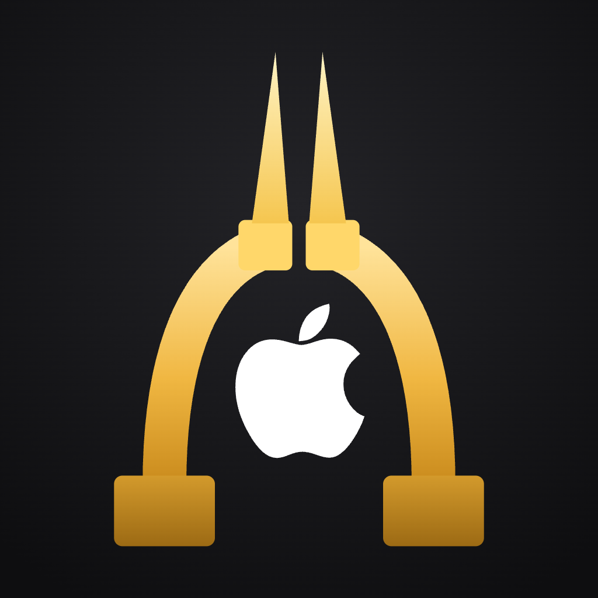
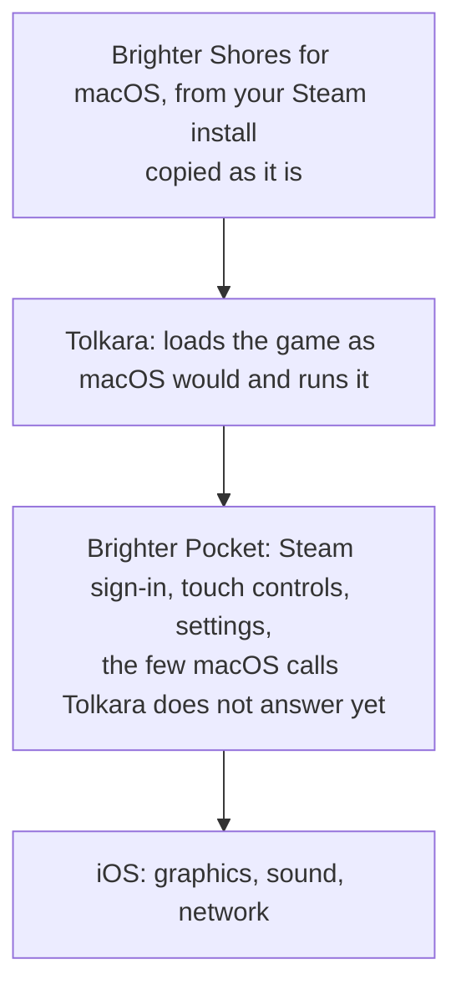

<p align="center">
  
</p>

# Brighter Pocket

**Play Brighter Shores on your iPhone or iPad.** You need a macOS device and a cable to set it up. Then
you play on the phone. [Jump to setting it up](#what-you-need).

Brighter Pocket runs the macOS version of Brighter Shores on an iPhone or iPad. A free macOS app,
**Brighter Pocket Companion**, builds it on your macOS device from this source code and sets it up with
your own Steam copy of the game; then you play on the phone, where it is called **Pocket**.

It is another way to play: the same idea as [GameNative](https://gamenative.app)
on Android, which Fen Research allows though doesn't officially support
([reference](#references)), here for iOS. The
game's client runs 100% unmodified, through [Tolkara](https://github.com/tolkara/tolkara), an
open-source compatibility layer (much like [Proton](https://github.com/ValveSoftware/Proton) or
[Wine](https://www.winehq.org) on Linux). Brighter Pocket is an unofficial fan project, part
of [Brighter Atlas](https://brighteratlas.com), free and open source (MIT), and not affiliated
with Fen Research, Valve or Apple.

- [What it does](#what-it-does)
- [How it runs the game](#how-it-runs-the-game)
- [Verify it yourself](#verify-it-yourself)
- [What you need](#what-you-need)
- [Set up](#set-up): automatic, with the companion
- [Manual setup](#manual-setup)
- [Playing](#playing)
- [Updates and upkeep](#updates-and-upkeep)
- [If something goes wrong](#if-something-goes-wrong)
- [Removing it](#removing-it)
- [Anonymous usage counts](#anonymous-usage-counts)
- [What has been tested](#what-has-been-tested)
- [How it works](#how-it-works)
- [For developers](#for-developers)
- [References](#references)

## What it does

Brighter Pocket runs the game's own macOS build natively on iOS. It is not an emulator and not a
port, and the game itself is not changed: the same files Steam installs on a Mac run directly on
the iPhone's processor. On top of that, Brighter Pocket adds what a phone needs:

- **Opens the game.** Opening Brighter Pocket starts Brighter Shores.
- **Signs in to Steam on the phone**, with your account name, password and Steam Guard, the way
  open-source Steam tools such as SteamKit and DepotDownloader do. The game uses that sign-in
  to reach its own servers, as it does on a macOS device.
- **Touch controls.** Tap to click, or a cursor mode that works like a trackpad. Pinch to zoom,
  an on-screen keyboard, and Bluetooth mice and keyboards.
- **Settings for a phone.** Frame rate up to 120 on ProMotion screens, portrait or landscape
  (on either screen of the iPhone Duo), a border clear of the notch, and where the on-screen
  buttons sit.
- **Game updates from Steam.** New builds download on the phone from Steam's own servers,
  each piece checked against Steam's checksums.
- **Switching apps.** The game keeps running while you use another app.

It works because Brighter Shores for macOS is built for Apple's arm64 processors, the same kind
iPhones and iPads use. What a phone lacks is macOS itself: its windows, parts of its graphics and
sound, and Steam. Brighter Pocket supplies those, on top of
[Tolkara](https://github.com/tolkara/tolkara), a compatibility layer that does for macOS apps on
iOS roughly what Wine or Proton does for Windows games on Linux.

## How it runs the game

- **Runs the game as Steam installed it.** The client file is copied byte for byte from your
  own Steam install, and its SHA-256 checksum is checked before and after the copy. The only
  change while loading it is the one macOS itself makes at every launch: filling in the
  addresses of the system functions the game calls. Valve's Steam library is the one file left
  out, as it needs a desktop Steam client; the app answers those Steam calls itself.
- **Leaves every move to you.** Each tap is one click. Brighter Pocket leaves the game's memory
  and screen alone and plays nothing by itself.
- **Lets the game talk to its own servers.** The game connects straight to Fen Research's
  servers over the phone's normal network. Brighter Pocket stays out of that connection and has
  no servers of its own.
- **Keeps your data between you and Steam.** Your password goes only to Steam, and the sign-in
  Steam returns is kept in the phone's keychain. On the phone the app talks to Steam (sign-in
  and game updates) and sends [anonymous usage counts](#anonymous-usage-counts) to Umami, which
  you can turn off. No accounts, ads or tracking across apps. The companion on the macOS device
  sends the same kind of counts, checks GitHub for its own updates, and downloads its build helper
  (XcodeGen) from there when Homebrew isn't installed.
- **Uses your own copy.** This repository and the app contain nothing from the game: you copy
  your own install from your own macOS device, so you need to own Brighter Shores on Steam.

Don't just take my word for it: see [Verify it yourself](#verify-it-yourself).

## Verify it yourself

*Not technical? You can skip this section.*

You don't have to take our word for anything here. The companion builds Brighter Pocket on your
own macOS device, with your own Xcode, from the source code it carries, which is this repository. So what
runs on your phone is code you can read.

- **Read it, or have it reviewed.** If you are not a programmer, ask an AI assistant to review
  this repository for you. For example: *"Review github.com/joenye/brighter-pocket. Does it
  change the Brighter Shores client, read the game's memory or screen, automate input, touch the
  game's network traffic, or send my Steam password or any data anywhere other than Steam, apart
  from the anonymous usage counts the README lists? Check each claim in its README against the
  code."*
- **Where to look.** The Steam sign-in and game updates are in `pocket/launcher/Pocket/`, the
  usage counts in `pocket/launcher/Pocket/PocketAnalytics.m` (the app) and
  `pocket/management/Analytics.swift` (the companion); the copy
  of the client and its checksum checks in `tools/stage_client.py` and
  `pocket/profiles/brighter-shores/`; every change to Tolkara is a numbered patch in
  `pocket/patches/`, each with its reason at the top.
- **Check the download.** Each companion release is built from this repository by GitHub Actions
  (`.github/workflows/release.yml`), with a public build record that ties the file to the commit
  it was built from. With the [GitHub CLI](https://cli.github.com):
  `gh attestation verify Brighter-Pocket-Companion.dmg -R joenye/brighter-pocket`. The release's
  `SHA256SUMS` lists each file's checksum.
- **Or skip the download.** Build the companion yourself: see [For developers](#for-developers).

## What you need

- **A macOS device with Apple silicon** (M1 or later) on **macOS 26.6 or later**, which the current Xcode
  needs. Windows PCs can't set it up.
- **An iPhone or iPad on iOS 17 or later**, with about 2 GB free, and a cable to connect it to
  the Mac. So far it has been played on an iPhone Duo with iOS 27.2; see
  [What has been tested](#what-has-been-tested).
- **[Xcode](https://apps.apple.com/app/xcode/id497799835)**, Apple's free app for building iPhone
  apps, from the Mac App Store. It is a big download and needs plenty of free space on the Mac
  (tens of GB), so start it first.
- **An Apple Account**, the one you use for the App Store. A free one should be enough. Apple
  only lets an iPhone run apps signed by someone, so you sign Pocket with your own account.
  With a free account the signature lasts seven days: once a week, plug the phone in and click
  **Renew Pocket** on the Mac. It takes a few minutes and nothing is lost. If you miss
  a week, Pocket just won't open until you do; your character is safe on the game's servers.
  An optional [Apple Developer Program](https://developer.apple.com/programs/enroll/) membership
  ($99 a year, paid to Apple) makes it once a year. This project costs nothing.
- **Steam on the Mac**, signed in, with **Brighter Shores installed** from your library. It is the
  same game you play on a PC: install it in Steam on the Mac too.

**On a Mac you don't manage** (a family Mac, for example): installing Xcode may need the Mac's
administrator password, and a phone with Screen Time limits may hide Developer Mode. Ask whoever
manages them.

### Before you start

1. **Install Xcode** from the Mac App Store and wait for it to finish.
2. **Open Xcode once.** Click **Agree** to its licence and type your login password. When it asks
   which platforms to download, tick **iOS** and click **Download**. Wait for it to finish, then
   quit Xcode.
3. **Sign in to Xcode** with your Apple Account: **Xcode > Settings > Apple Accounts**, click
   **+**, choose **Apple Account** and sign in. Your free "Personal Team" appears there; that is
   all Xcode needs.

## Set up

There are two ways. **Automatic** (recommended): Brighter Pocket Companion does it all, below.
**Manual**: run each step yourself in Terminal ([Manual setup](#manual-setup)). Both build the
same app from the same source.

One macOS app, **Brighter Pocket Companion**, does the work. It checks what you have, builds the
app from its source with your Apple Account, installs it on your phone and copies the game over.

### 1. Get the companion

Download
[**Brighter-Pocket-Companion.dmg**](https://github.com/joenye/brighter-pocket/releases/latest/download/Brighter-Pocket-Companion.dmg)
(from the [latest release](https://github.com/joenye/brighter-pocket/releases/latest)), open it
and drag **Brighter Pocket Companion** to Applications. Releases are signed with the project's
Developer ID and notarized by Apple, so it opens like any other app. It keeps itself up to date: it checks for new versions,
shows what changed and installs an update when you say so. **Check for Updates** is in the app
menu, Settings turns the automatic checks off, and **Help > What's New in Brighter Pocket Companion**
shows what changed in your version.

If macOS ever says it cannot verify the companion (a copy you built yourself, for example), it
is the normal warning for an app from outside the App Store. Click **Done**, open **System Settings > Privacy & Security**,
scroll down, click **Open Anyway** beside Brighter Pocket Companion and confirm with your macOS
password.

### 2. Follow the steps in the app

The steps are listed down the left side. Each one checks itself and turns green when it is
done; click **Continue** to move on.

1. **This Mac.** Checks for Xcode. If it is missing, click **Get Xcode**. If Xcode has never
   been opened, the step shows what to click the first time. It also installs a small build
   helper by itself.
2. **Apple Account.** Finds your account in Xcode. With a free account it shows your name with
   "(Personal Team)"; that is fine. If it finds nothing, follow the numbered steps it shows to
   sign in to Xcode.
3. **iPad or iPhone.** Connect it with the cable and unlock it. Tap **Trust** when the phone asks
   whether to trust this computer.

   The phone also needs **Developer Mode**, an Apple setting that lets it run apps you build
   yourself. On the phone open **Settings > Privacy & Security > Developer Mode**, turn it on and
   tap **Restart**. After the restart, unlock it, tap **Turn On** and enter your passcode.
   Apple's warning about security is its standard wording. If you can't find the setting, the
   step shows what to do.
4. **Brighter Shores.** The companion finds the game in Steam by itself. If it isn't installed
   yet, click **Install Brighter Shores in Steam**. Then click **Continue**.
5. **Install Pocket.** Click **Install Pocket** and keep the phone connected and unlocked. The
   first build takes a few minutes. It builds the app, installs it, and makes a copy of the
   game's code signed with your Apple Account (iPhones only run signed code). macOS then asks
   whether `export_signing_identity` may use a key in your keychain. That is expected: the key
   lets your phone sign game updates by itself, and it only works for apps on your own devices.
   Click **Allow** and type your login password. You can cancel the key any time at
   [developer.apple.com/account](https://developer.apple.com/account).

   With a free account, the phone then needs you to trust your own name once: on the phone open
   **Settings > General > VPN & Device Management**, tap **Apple Development** with your email,
   then **Trust**. (The setting has "VPN" in its name; nothing about a VPN is involved.) Then
   click **Open Pocket on iPhone** (or iPad) in the companion.
6. **Copy Brighter Shores.** Click **Copy to iPhone** (or iPad). About 1 GB is copied over the
   cable; it takes a few minutes.
7. **Play.** Click **Open Pocket on iPhone**, or open **Pocket** on the phone. The game starts by
   itself. You can unplug the cable.

### 3. The first start on the phone

Brighter Pocket is called **Pocket** on the Home Screen. Opening it starts the game. The first
time:

- If iOS says **Untrusted Developer**, open **Settings > General > VPN & Device Management**, tap
  **Apple Development** with your email, tap **Trust**, and open Pocket again. (The setting has
  "VPN" in its name; nothing about a VPN is involved.)
- Once the game reaches its main menu, the app offers to **sign in to Steam**. Use the account
  with Brighter Shores in its library. Your password goes straight to Steam, as if you typed it
  on Steam's own website, and isn't saved: Steam gives the phone a sign-in pass, kept in the
  phone's locked storage. Approve the sign-in in the Steam Mobile app, or type the Steam Guard
  code Steam emails you. You are not asked again. **Not Now** skips signing in (you need it to
  play online); the settings
  have **Sign In to Steam** for later.

After that the game signs in to its own servers as it does on a macOS device.

## Manual setup

Everything the companion does is a script in this repository, so you can do it yourself. You
need the same things as above, plus [Homebrew](https://brew.sh) for XcodeGen. Run these in
Terminal:

1. **Get the source and its tools.**

   ```bash
   git clone https://github.com/joenye/brighter-pocket && cd brighter-pocket
   brew install xcodegen
   ```

2. **Copy your game from Steam** (about 1 GB, into the ignored `client/` folder):

   ```bash
   python3 tools/fetch_client.py
   ```

3. **Your settings.** `cp local.env.example local.env`, then set in `local.env`:
   - `DEVELOPMENT_TEAM`: your team ID (Xcode > Settings > Apple Accounts);
   - `DEVICE`: your phone's ID, from `xcrun devicectl list devices` with it connected;
   - `TOLKARA_BUNDLE_ID`: any name unique to you, such as `com.yourname.pocket`;
   - `GUEST_EXE`: the full path of the game that step 2 copied, ending in
     `client/<folder>/x64arm64/Brighter Shores.app/Contents/MacOS/Brighter Shores`;
   - `TOLKARA_MODE=local-signing`, and with a free Apple Account also `TOLKARA_SIGNING=personal`.

4. **Build and install Pocket**, with the phone connected and unlocked:

   ```bash
   python3 tools/prepare.py && (cd build/platform && tools/install.sh)
   ```

5. **Copy the game to the phone:**

   ```bash
   python3 build/platform/profiles/brighter-shores/install.py \
       --source "$HOME/Library/Application Support/Steam/steamapps/common/Brighter Shores"
   ```

Then open Pocket on the phone, as in [the first start](#3-the-first-start-on-the-phone). To renew
the app's signature later, run step 4 again. [docs/building.md](docs/building.md) has the details
and the other options.

## Playing

- **Touch** mode: tap where you would click.
- **Cursor** mode: slide to move a cursor, tap to click, double-tap or two-finger tap to
  right-click, two fingers to scroll. **Cursor speed** is in the settings.
- **Pinch to zoom** works in both modes.
- The keyboard button opens the on-screen keyboard. A Bluetooth keyboard and mouse also work.
- The small arrow beside the buttons folds them away and brings them back. **Controls** in the
  settings moves them to any corner, in a row or a column.

The gear opens the settings:

- **Steam**: who is signed in, or what is wrong (Steam unreachable, the game running on another
  device, a sign-in Steam no longer accepts), **Sign In to Steam** to fix it without leaving
  the game, and **Sign Out of Steam** to forget the sign-in (to switch accounts, say). A dot on
  the gear shows when something has changed.
- **Brighter Shores > Builds**: the game's version on the phone and the latest on Steam, with
  **Check for Updates**.
- **Display**: frame rate (as fast as the screen allows, up to 120 on ProMotion screens, or
  lower to save battery), a frame-rate overlay, orientation, and a border that keeps the game
  clear of the notch and rounded corners.
- **Controls**: touch or cursor, cursor speed, pinch to zoom, and where the buttons sit.
- **About**: versions and credits.

You can switch to another app and come back. The game keeps running while its sound plays.
As with Steam, the game plays on one device at a time: if it is running on your PC, the phone
asks before taking over, which closes it there.

## Updates and upkeep

- **Game updates.** Each time the app opens, and while you play, it asks Steam for the latest
  build. If there is one, it downloads only the changed files from Steam and installs them before
  the game starts, or next time if it arrived mid-game. A note over the game says which. The
  previous version is kept until the new one has started; if the new one does not start (it may
  need something Brighter Pocket was not built for), the app offers to go back. Older versions
  are then removed.
- **Every seven days with a free account, or once a year with a paid one,** Apple's signature
  runs out and Pocket stops opening. Pocket shows the date in **Settings > About**, and warns on
  its loading screen two days before. Connect the phone, open Brighter Pocket Companion on the
  Mac and click **Renew Pocket**; from two days before, the companion opens straight to it. The
  game and your settings stay on the phone. Missed it? Nothing is lost: renew whenever you're
  ready.
- **Updating Brighter Pocket itself.** The companion checks for new versions of itself, shows
  what's new and installs the update when you say so. Then run the Install step again to update
  the app on the phone.

## If something goes wrong

- **"Can't reach Steam right now" or sign-in errors.** Check the phone is online and open the **Steam** section
  of the settings in the game; it says what is wrong and offers **Sign In to Steam**.
- **"Unable to login" in the game.** Usually the Steam sign-in has lapsed or the game is open on
  another device. The settings' Steam section shows which.
- **The app stops opening** after seven days (free account) or a year (paid). See
  [Updates and upkeep](#updates-and-upkeep).
- **The game does not start.** Close Pocket in the app switcher and open it again. If it stops
  again, tap **Details and Logs** on the loading screen and share what it says (see below).
- **Anything else**: ask in the [Brighter Atlas Discord](https://discord.gg/XQeGGaBexH), or
  [open an issue](https://github.com/joenye/brighter-pocket/issues) if you have a GitHub
  account. Say which phone and iOS version you have and what you saw. Never post your Steam
  password.

## Removing it

In the game's settings, tap **Sign Out of Steam** first. Then delete **Pocket** from the phone.
That removes the app and the copied game. iOS may keep
an app's keychain entries (here, the Steam sign-in token and the signing identity) after the
app is deleted, so to end the Steam sign-in for certain, use **Deauthorize all other devices** in
Steam's settings, and revoke the certificate at
[developer.apple.com/account](https://developer.apple.com/account) if you no longer want it.
Turn off Developer Mode if you do not need it for anything else. On the macOS device, delete **Brighter
Pocket Companion** and its work folder, `~/Library/Application Support/Brighter Pocket Companion/`.

## Anonymous usage counts

To know how many people use Brighter Pocket and where setting it up goes wrong, the companion
and the app send anonymous counts to [Umami](https://umami.is), the same cookieless analytics
[brighteratlas.com](https://brighteratlas.com) uses. Umami keeps no cookies and tells visits apart
by a hash that changes every day.

- **The companion** counts the step on screen, opening it (and whether it is the first time on
  this macOS device), leaving a step with Continue, whether the Apple Account is free or paid,
  whether the device is an iPhone or iPad and its iOS version, and how each job ended (install,
  renewal, copy, pairing): finished, stopped or failed, with the title of the problem it showed
  and how long it took.
- **The app on the phone** counts opening it (the app's version, iPhone or iPad, the iOS
  version), the Steam sign-in being shown, put off, finished, cancelled or failed (with Steam's
  error number or a one-word reason, and which kind of Steam Guard it used), signing out, the
  game's window coming up, the check for a game update (updated, nothing new, or failed), and the
  renewal warning.
- **Never sent:** your Steam account, password or sign-in, your Apple Account or team, your email,
  your device's name, file paths, or anything from the game.
- **Turning them off:** in the companion, **Settings > General > Share anonymous usage counts**;
  on the phone, **Anonymous Usage Counts** in Pocket's settings. Off sends nothing. The code is
  `pocket/management/Analytics.swift` and `pocket/launcher/Pocket/PocketAnalytics.m`.

## What has been tested

As of 13 November 2026:

- **Played** on one iPhone, an iPhone Duo (both screens) with iOS 27.2: signed in to Steam, on
  the game's servers, in the world, at up to 120 frames a second.
- **Checked on the macOS device** for every change: that the client copied is identical to Steam's, that
  every macOS function it calls has an iOS answer, and that its startup runs in an emulator
  (`tests/run.sh`).
- **Not yet tried**: a build from a free Apple Account on a device (it leaves out two memory
  settings a free account cannot sign; the game is expected to fit without them, but that is
  not measured yet), iPads on a real device (only in Apple's simulator), a game update arriving
  on the phone (tested on the macOS device against Steam), and long sessions.
- **Known gaps**: in-game purchases need the Steam overlay, which phones do not have; the game's
  share menu does nothing.

[docs/status.md](docs/status.md) has the full record.

## How it works



iOS only runs code signed by a developer. The companion makes a copy of the game's code pages
signed with your own Apple Account, and the app runs those (Local signing). After a game update,
the phone makes and signs a new copy itself. The signed copy is byte for byte the game's own code.

Tolkara is included unchanged in `platform/`. Every change Brighter Pocket makes to it is a
numbered patch in `pocket/patches/` with its reason. [docs/architecture.md](docs/architecture.md)
goes into detail.

## For developers

```bash
cp local.env.example local.env          # DEVELOPER_DIR if Xcode is not the selected one; STEAM_USER
python3 -m venv .venv && .venv/bin/pip install zstandard pymobiledevice3
.venv/bin/python tools/fetch_client.py  # the game from your macOS device's Steam install, into client/
tests/run.sh                            # every check that runs without a device
tools/make_companion.sh --dmg           # build/Brighter Pocket Companion.app and .dmg
```

[docs/releasing.md](docs/releasing.md) covers releasing the companion, [docs/building.md](docs/building.md) building manually (a device, the iOS Simulator, an
unsigned `.ipa`), [docs/emulator.md](docs/emulator.md) the emulator used for checks, and
[docs/client-analysis.md](docs/client-analysis.md) what the client needs from iOS.

|Path|What|
|---|---|
|`platform/`|Tolkara, unchanged, at the commit in `pocket/platform.lock`|
|`pocket/`|Brighter Pocket: adapters (`translation/`), the Steam sign-in and updates (`launcher/Pocket/`), the companion's changes (`management/`), `patches/`|
|`tools/`|copy and check the client, prepare the tree, build the app and the companion|
|`emulator/`|runs the client's startup on the macOS device for checks|
|`tests/`|`run.sh` and the tests it builds|
|`client/`, `build/`|ignored: your copy of the game, and what is built|

## References

- **GameNative.** Fen Research Customer Support, replying by email to a player who asked whether
  playing through GameNative is allowed (13 November 2026): "GameNative is not officially
  supported by us and so we can provide no guarantee that it will work, but you are welcome to
  use it."

## Credits and licence

MIT ([LICENSE](LICENSE)). Built on [Tolkara](https://github.com/tolkara/tolkara); other credits are
in [NOTICE.md](NOTICE.md). Brighter Shores is Fen Research's. Brighter Pocket is not affiliated with
or endorsed by Fen Research, Valve or Apple.
