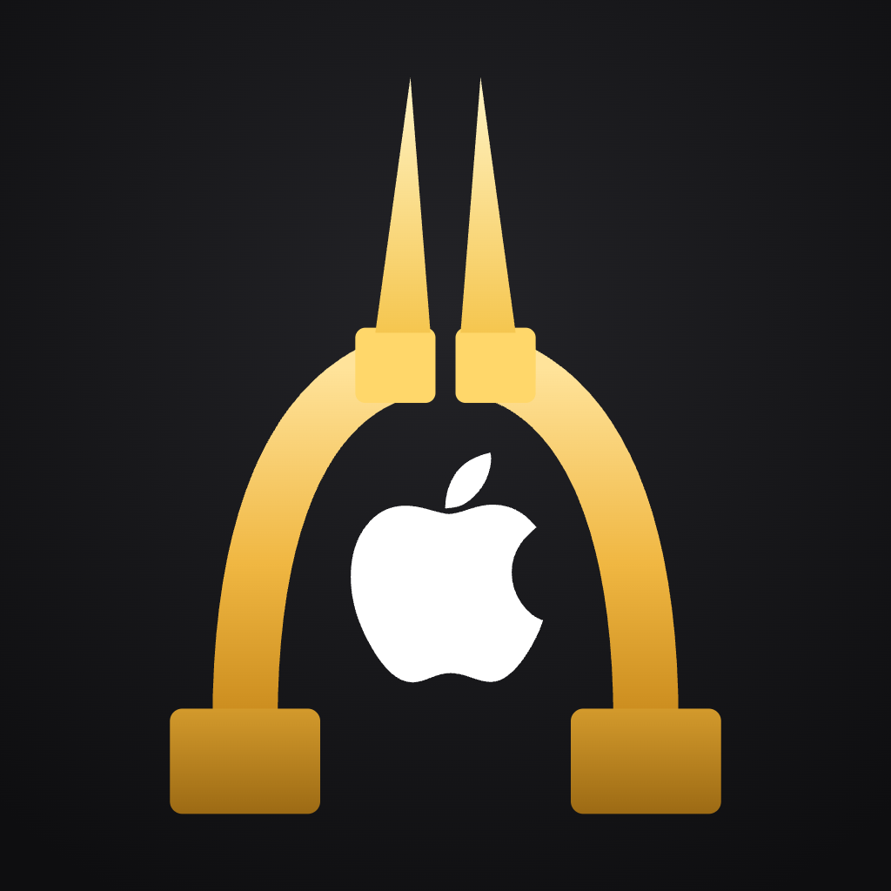

<p align="center">
  
</p>

# Brighter Pocket

**Play Brighter Shores natively on your iPhone or iPad.** Free and open source.

Brighter Pocket runs the game's own macOS version on iOS, unmodified, through
[Tolkara](https://github.com/tolkara/tolkara), an open-source compatibility layer (much like
[Wine](https://www.winehq.org) or [Proton](https://github.com/ValveSoftware/Proton) on Linux). It's
the same idea as [GameNative](https://gamenative.app) on Android, which Fen Research has told
players they're welcome to use ([reference](#references)). You install it from a macOS device with
the free **Brighter Pocket Companion**, then play on the phone, where the app is called **Pocket**.

[Website](https://brighteratlas.com/pocket) · [Demo video](https://youtu.be/mTfPaKSjt6o) ·
[Discord](https://discord.gg/XQeGGaBexH) · [Jump to installation](#installation)

- [Features](#features)
- [How it works](#how-it-works)
- [Verify it yourself](#verify-it-yourself)
- [Installation](#installation): [guided](#guided-setup-recommended) or [manual](#manual-setup)
- [Updates and renewing](#updates-and-renewing)
- [If something goes wrong](#if-something-goes-wrong)
- [Removing it](#removing-it)
- [Anonymous usage counts](#anonymous-usage-counts)
- [What has been tested](#what-has-been-tested)
- [For developers](#for-developers)

## Features

- **Native, not streamed.** The game runs on your phone itself.
- **Steam sign-in.** Sign in once, on your phone.
- **Touch or cursor.** Tap to click, or move a cursor like a trackpad.
- **Pinch and keyboard.** Pinch to zoom, an on-screen keyboard, and Bluetooth mice and keyboards.
- **Smooth.** Up to 120 fps on ProMotion screens, or less to save battery.
- **Any orientation.** Landscape or portrait.
- **Game updates.** Downloaded on the phone, straight from Steam.
- **Switch apps.** Check another app and come back.

## How it works

1. **The macOS version.** Brighter Shores has an official version for macOS, built for the same
   kind of processor iPhones and iPads use.
2. **Moved to iOS, unchanged.** That same version is copied, exactly as it is, to your iPhone or
   iPad. On its own it can't start: iOS is missing parts of macOS the game needs.
3. **Tolkara fills the gap.** Tolkara answers the game's macOS calls with iOS's own, so the game
   runs natively on your phone.
4. **Wrapped in Brighter Pocket.** Brighter Pocket wraps it all in an app, with Steam sign-in,
   touch controls and updates. You build and install it yourself, not from the App Store.

What that means in practice:

- **The game is never changed.** The client is copied byte for byte from your own Steam install,
  its SHA-256 checked before and after. Loading it only fills in the addresses of the system
  functions it calls, as macOS does at every launch. Valve's Steam library is left out (it needs
  desktop Steam); the app answers those calls itself.
- **No automation.** Each tap is one click. Brighter Pocket leaves the game's memory and
  screen alone and plays nothing by itself.
- **The game talks to its own servers**, directly, over the phone's network. Brighter Pocket has no
  servers of its own.
- **Your password goes only to Steam.** The sign-in Steam returns is kept in the phone's keychain.
  Besides Steam, the app and the companion send only [anonymous usage counts](#anonymous-usage-counts),
  which you can turn off; the companion also checks GitHub for its own updates.
- **Nothing from the game is included.** You copy your own install, so you need to own
  Brighter Shores on Steam.

iOS only runs signed code, so the companion makes a copy of the game's code signed with your own
Apple Account, byte for byte the game's own; after a game update the phone signs the new copy
itself. Every change Brighter Pocket makes to Tolkara is a numbered patch in `pocket/patches/`;
[docs/architecture.md](docs/architecture.md) has the details.

## Verify it yourself

You don't have to take our word for any of this. The companion builds Brighter Pocket on your own
macOS device, with your own Xcode, from this repository, so what runs on your phone is code you
can read.

- **Have it reviewed.** Not a programmer? Ask an AI assistant, for example: *"Review
  github.com/joenye/brighter-pocket. Does it change the Brighter Shores client, read the game's
  memory or screen, automate input, touch the game's network traffic, or send my Steam password
  or any data anywhere other than Steam, apart from the anonymous usage counts the README lists?
  Check each claim in its README against the code."*
- **Where to look.** Steam sign-in and game updates: `pocket/launcher/Pocket/`. Usage counts:
  `pocket/launcher/Pocket/PocketAnalytics.m` and `pocket/management/Analytics.swift`. Copying and
  checking the client: `tools/stage_client.py` and `pocket/profiles/brighter-shores/`. Changes to
  Tolkara: `pocket/patches/`, each with its reason at the top.
- **Check the download.** Each companion release is built by GitHub Actions
  (`.github/workflows/release.yml`) with a public build record tying it to its commit:
  `gh attestation verify Brighter-Pocket-Companion.dmg -R joenye/brighter-pocket`. The release's
  `SHA256SUMS` lists each file's checksum.
- **Or build the companion yourself**: see [For developers](#for-developers).

<a name="set-up"></a>

## Installation

### What you need

- A macOS device with Apple silicon (M1 or later), on macOS 26.6 or later. Windows PCs can't set
  it up.
- An iPhone or iPad on iOS 17 or later, about 2 GB free, and a cable.
- [Xcode](https://apps.apple.com/app/xcode/id497799835), free from the Mac App Store (a big
  download: start it first).
- Your Apple Account, signed in to Xcode (a free one should do).
- [Brighter Shores](https://store.steampowered.com/app/2791440/Brighter_Shores/) installed through
  Steam on that macOS device.

With a free Apple Account, you renew Brighter Pocket from your macOS device once a week; miss one
and nothing is lost. An [Apple Developer Program](https://developer.apple.com/programs/)
membership ($99 a year, paid to Apple) makes it once a year.

On a Mac or phone someone else manages, installing Xcode may need the Mac's administrator
password, and Screen Time limits may hide Developer Mode.

### Guided setup (recommended)

**Brighter Pocket Companion** is a free macOS app that helps you build and install Brighter Pocket
on your iPhone or iPad.

**Before you start**, prepare Xcode: open it once, click **Agree** and type your password, tick
**iOS** when it asks which platforms to download, then sign in at **Xcode > Settings > Apple
Accounts** (**+**, **Apple Account**). Your free "Personal Team" appears there; that's all it needs.

1. **Download** [**Brighter-Pocket-Companion.dmg**](https://github.com/joenye/brighter-pocket/releases/latest/download/Brighter-Pocket-Companion.dmg),
   open it and drag the companion to Applications. Releases are signed and notarized by Apple, so
   it opens like any other app, and it keeps itself up to date.
2. **Follow the steps in the app.** Each one checks itself and turns green; click **Continue**.
   - **This Mac** checks for Xcode and installs a small build helper.
   - **Apple Account** finds your account in Xcode.
   - **iPad or iPhone**: connect it, unlock it and tap **Trust**. Turn on **Developer Mode** on
     the phone (**Settings > Privacy & Security > Developer Mode**, then **Restart**, **Turn On**
     and your passcode).
   - **Brighter Shores** finds the game in Steam.
   - **Install Pocket** builds and installs the app (a few minutes the first time; keep the
     phone connected and unlocked). macOS asks whether `export_signing_identity` may use a key in
     your keychain: click **Allow** and type your password. The key lets your phone sign game
     updates itself, and works only for your own devices. With a free account, then trust
     yourself on the phone: **Settings > General > VPN & Device Management**, tap **Apple
     Development**, then **Trust** (nothing to do with a VPN).
   - **Copy Brighter Shores** copies the game over the cable (about 1 GB).
   - **Play** opens Pocket on the phone. You can unplug the cable.
3. **Sign in to Steam on the phone.** Once the game reaches its main menu, Pocket offers to sign
   in. Your password goes straight to Steam and isn't saved; approve the sign-in in the Steam
   Mobile app or type the Steam Guard code. You're not asked again.

### Manual setup

Everything the companion does is a script here, so you can do it yourself in Terminal. You need
the same things, plus [Homebrew](https://brew.sh).

1. **Get the source and XcodeGen:**

   ```bash
   git clone https://github.com/joenye/brighter-pocket && cd brighter-pocket
   brew install xcodegen
   ```

2. **Copy your game from Steam** (about 1 GB, into the ignored `client/`):

   ```bash
   python3 tools/fetch_client.py
   ```

3. **Your settings:** `cp local.env.example local.env`, then set:
   - `DEVELOPMENT_TEAM`: your team ID (Xcode > Settings > Apple Accounts);
   - `DEVICE`: your phone's ID, from `xcrun devicectl list devices`;
   - `TOLKARA_BUNDLE_ID`: any name unique to you, such as `com.yourname.pocket`;
   - `GUEST_EXE`: the game step 2 copied, ending in
     `client/<folder>/x64arm64/Brighter Shores.app/Contents/MacOS/Brighter Shores`;
   - `TOLKARA_MODE=local-signing`, and with a free Apple Account `TOLKARA_SIGNING=personal`.

4. **Build and install Pocket**, with the phone connected and unlocked:

   ```bash
   python3 tools/prepare.py && (cd build/platform && tools/install.sh)
   ```

5. **Copy the game to the phone:**

   ```bash
   python3 build/platform/profiles/brighter-shores/install.py \
       --source "$HOME/Library/Application Support/Steam/steamapps/common/Brighter Shores"
   ```

Then open Pocket and sign in to Steam, as above. To renew, run step 4 again.
[docs/building.md](docs/building.md) has the other options.

## Updates and renewing

- **Game updates** download on the phone from Steam each time Pocket opens, only the changed
  files, each checked against Steam's checksums. If a new version won't start, Pocket offers to
  go back to the previous one.
- **Renewing:** with a free account, Apple's signature lasts seven days (a year with a paid one).
  Pocket warns two days before. Connect the phone, open the companion and click **Renew Pocket**.
  Missed it? Pocket won't open until you renew, but nothing is lost.
- **Brighter Pocket itself:** the companion offers its own updates; then run **Install Pocket**
  again to update the phone.

## If something goes wrong

- **Steam sign-in errors, or "Unable to login" in the game:** open **Steam** in Pocket's settings.
  It says what's wrong (offline, the sign-in lapsed, the game open on another device) and offers
  **Sign In to Steam**.
- **Pocket stops opening:** renew it (see above).
- **The game doesn't start:** close Pocket in the app switcher and open it again. If it still
  fails, tap **Details and Logs** on the loading screen.
- **Anything else:** ask in the [Brighter Atlas Discord](https://discord.gg/XQeGGaBexH) or
  [open an issue](https://github.com/joenye/brighter-pocket/issues), with your phone, iOS version
  and what you saw. Never post your Steam password.

## Removing it

Tap **Sign Out of Steam** in Pocket's settings, then delete Pocket from the phone. iOS may keep its
keychain entries, so to be certain, use **Deauthorize all other devices** in Steam and revoke the
certificate at [developer.apple.com/account](https://developer.apple.com/account). On the Mac,
delete the companion and `~/Library/Application Support/Brighter Pocket Companion/`.

## Anonymous usage counts

To know how many people use Brighter Pocket and where setting it up goes wrong, the companion and
the app send anonymous counts to [Umami](https://umami.is), the cookieless analytics
[brighteratlas.com](https://brighteratlas.com) uses.

- **The companion** counts the step on screen, opening it (and whether it's the first time on this
  Mac), leaving a step with Continue, whether the Apple Account is free or paid, iPhone or iPad
  and its iOS version, and how each job ended (install, renewal, copy, pairing): finished,
  stopped or failed, with the problem's title and how long it took.
- **The app** counts opening it (its version, iPhone or iPad, iOS version), the Steam sign-in
  being shown, put off, finished, cancelled or failed (with Steam's error number or a one-word
  reason, and the kind of Steam Guard), signing out, the game's window coming up, the game update
  check (updated, nothing new, or failed), and the renewal warning.
- **Never sent:** your Steam account, password or sign-in, Apple Account or team, email, device
  name, file paths, or anything from the game.
- **Turning them off:** **Settings > General > Share anonymous usage counts** in the companion;
  **Anonymous Usage Counts** in Pocket's settings.

## What has been tested

As of 13 November 2026, played on an iPhone Duo (both screens) with iOS 27.2: signed in to Steam,
in the world, at up to 120 fps. Every change is checked on the Mac (`tests/run.sh`). Not yet tried
on a real device: a free Apple Account build, iPads (only in the simulator), a game update
arriving, long sessions. Known gaps: in-game purchases (they need the Steam overlay) and the
game's share menu. [docs/status.md](docs/status.md) has the full record.

## For developers

```bash
cp local.env.example local.env          # DEVELOPER_DIR if Xcode is not the selected one; STEAM_USER
python3 -m venv .venv && .venv/bin/pip install zstandard pymobiledevice3
.venv/bin/python tools/fetch_client.py  # the game from the Mac's Steam install, into client/
tests/run.sh                            # every check that runs without a device
tools/make_companion.sh --dmg           # build/Brighter Pocket Companion.app and .dmg
```

[docs/building.md](docs/building.md): building by hand (device, simulator, `.ipa`).
[docs/releasing.md](docs/releasing.md): releases. [docs/emulator.md](docs/emulator.md): the
emulator used for checks. [docs/client-analysis.md](docs/client-analysis.md): what the client
needs from iOS.

|Path|What|
|---|---|
|`platform/`|Tolkara, unchanged, at the commit in `pocket/platform.lock`|
|`pocket/`|Brighter Pocket: adapters, Steam sign-in and updates (`launcher/Pocket/`), the companion (`management/`), `patches/`|
|`tools/`|copy and check the client, prepare the tree, build the app and the companion|
|`emulator/`|runs the client's startup on the Mac for checks|
|`tests/`|`run.sh` and the tests it builds|
|`client/`, `build/`|ignored: your copy of the game, and builds|

## References

- **GameNative.** Fen Research Customer Support, by email to a player who asked whether playing
  through GameNative is allowed (13 November 2026): "GameNative is not officially supported by us
  and so we can provide no guarantee that it will work, but you are welcome to use it."

  [](https://brighteratlas.com/landing/pocket-fen-reply.webp)

## Credits and licence

MIT ([LICENSE](LICENSE)). Built on [Tolkara](https://github.com/tolkara/tolkara); other credits in
[NOTICE.md](NOTICE.md). Brighter Shores is Fen Research's. Brighter Pocket is a fan project, not
affiliated with or endorsed by Fen Research, Valve or Apple.
