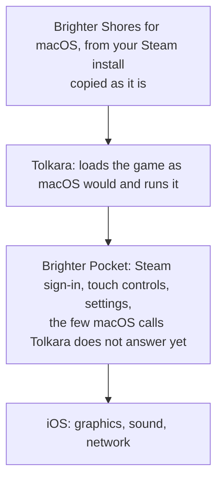

<p align="center">
  
</p>

# Brighter Pocket

Brighter Pocket runs the macOS version of Brighter Shores on an iPhone or iPad. A free macOS app,
**Brighter Pocket Companion**, builds it on your macOS device from this source code and sets it up with
your own Steam copy of the game; then you play on the phone, where it is called **Pocket**.

It is another way to play: the same idea as [GameNative](https://gamenative.app)
on Android, which Fen Research allows though doesn't officially support
([reference](#references)), here for iOS. The
game's client runs 100% unmodified, through [Tolkara](https://github.com/tolkara/tolkara), an
open-source compatibility layer (much like [Proton](https://github.com/ValveSoftware/Proton) or
[Wine](https://www.winehq.org) on Linux). Brighter Pocket is an unofficial fan project, part
of [Brighter Atlas](https://brighteratlas.com), free and open source (MIT), and not affiliated
with Fen Research, Valve or Apple.

- [What it does](#what-it-does)
- [How it runs the game](#how-it-runs-the-game)
- [Check it yourself](#check-it-yourself)
- [What you need](#what-you-need)
- [Set up](#set-up), with the companion
- [Set up by hand](#set-up-by-hand)
- [Playing](#playing)
- [Updates and upkeep](#updates-and-upkeep)
- [If something goes wrong](#if-something-goes-wrong)
- [Removing it](#removing-it)
- [What has been tested](#what-has-been-tested)
- [How it works](#how-it-works)
- [For developers](#for-developers)
- [References](#references)

## What it does

- **Opens the game.** Opening Brighter Pocket starts Brighter Shores.
- **Signs in to Steam on the phone**, with your account name, password and Steam Guard, the way
  open-source Steam tools such as SteamKit and DepotDownloader do. The game uses that sign-in
  to reach its own servers, as it does on a macOS device.
- **Touch controls.** Tap to click, or a cursor mode that works like a trackpad. Pinch to zoom,
  an on-screen keyboard, and Bluetooth mice and keyboards.
- **Settings for a phone.** Frame rate up to 120 on ProMotion screens, portrait or landscape
  (on either screen of the iPhone Duo), a border clear of the notch, and where the on-screen
  buttons sit.
- **Game updates from Steam.** New builds download on the phone from Steam's own servers,
  each piece checked against Steam's checksums.
- **Switching apps.** The game keeps running while you use another app.

It works because Brighter Shores for macOS is built for Apple's arm64 processors, the same kind
iPhones and iPads use. What a phone lacks is macOS itself: its windows, parts of its graphics and
sound, and Steam. Brighter Pocket supplies those, on top of
[Tolkara](https://github.com/tolkara/tolkara), a compatibility layer that does for macOS apps on
iOS roughly what Wine or Proton does for Windows games on Linux.

## How it runs the game

- **Runs the game as Steam installed it.** The client file is copied byte for byte from your
  own Steam install, and its SHA-256 checksum is checked before and after the copy. The only
  change while loading it is the one macOS itself makes at every launch: filling in the
  addresses of the system functions the game calls. Valve's Steam library is the one file left
  out, as it needs a desktop Steam client; the app answers those Steam calls itself.
- **Leaves every move to you.** Each tap is one click. Brighter Pocket leaves the game's memory
  and screen alone and plays nothing by itself.
- **Lets the game talk to its own servers.** The game connects straight to Fen Research's
  servers over the phone's normal network. Brighter Pocket stays out of that connection and has
  no servers of its own.
- **Keeps your data between you and Steam.** Your password goes only to Steam, and the sign-in
  Steam returns is kept in the phone's keychain. On the phone the app talks only to Steam
  (sign-in and game updates). No analytics, accounts or tracking. The companion on the macOS device
  also checks GitHub for its own updates.
- **Uses your own copy.** This repository and the app contain nothing from the game: you copy
  your own install from your own macOS device, so you need to own Brighter Shores on Steam.

None of this needs taking on trust: see [Check it yourself](#check-it-yourself).

## Check it yourself

You don't have to take our word for anything here. The companion builds Brighter Pocket on your
own macOS device, with your own Xcode, from the source code it carries, which is this repository. So what
runs on your phone is code you can read.

- **Read it, or have it reviewed.** If you are not a programmer, ask an AI assistant to review
  this repository for you. For example: *"Review github.com/joenye/brighter-pocket. Does it
  change the Brighter Shores client, read the game's memory or screen, automate input, touch the
  game's network traffic, or send my Steam password or any data anywhere other than Steam? Check
  each claim in its README against the code."*
- **Where to look.** The Steam sign-in and game updates are in `pocket/launcher/Pocket/`; the copy
  of the client and its checksum checks in `tools/stage_client.py` and
  `pocket/profiles/brighter-shores/`; every change to Tolkara is a numbered patch in
  `pocket/patches/`, each with its reason at the top.
- **Check the download.** Each companion release is built from this repository by GitHub Actions
  (`.github/workflows/release.yml`), with a public build record that ties the file to the commit
  it was built from. With the [GitHub CLI](https://cli.github.com):
  `gh attestation verify Brighter-Pocket-Companion.dmg -R joenye/brighter-pocket`. The release's
  `SHA256SUMS` lists each file's checksum.
- **Or skip the download.** Build the companion yourself: see [For developers](#for-developers).

## What you need

- A macOS device with macOS 14 or later, and a cable for your iPhone or iPad.
- An iPhone or iPad. It has been played on one iPhone so far, an iPhone Duo with iOS 27.2; see
  [What has been tested](#what-has-been-tested).
- An Apple Account, signed in to Xcode. iOS runs only code signed by a developer, and the setup
  signs Brighter Pocket with your own account. A free account works, but Apple's signature from
  a free account lasts seven days: once a week the app stops opening until you plug the phone
  in and click **Build and Install Again** on the macOS device (a few minutes; your game and settings
  stay). A paid [Apple Developer Program](https://developer.apple.com/programs/enroll/)
  membership ($99 a year, paid to Apple) makes that once a year instead. This project costs
  nothing.
- Xcode, free from the Mac App Store. It is a large download, so start it first.
- Steam on the macOS device, signed in to the account that owns Brighter Shores, with Brighter Shores
  for macOS installed.

Set aside about an hour the first time, most of it waiting for downloads and the first build.

## Set up

There are two ways: let **Brighter Pocket Companion** do it all (below, recommended), or run
each step yourself in Terminal ([Set up by hand](#set-up-by-hand)). Both build the same app from
the same source.

One macOS app, **Brighter Pocket Companion**, does the work. It checks what you have, builds the
app from its source with your Apple Account, installs it on your phone and copies the game over.

### 1. Get the companion

Download
[**Brighter-Pocket-Companion.dmg**](https://github.com/joenye/brighter-pocket/releases/latest/download/Brighter-Pocket-Companion.dmg)
(from the [latest release](https://github.com/joenye/brighter-pocket/releases/latest)), open it
and drag **Brighter Pocket Companion** to Applications. Releases are signed and notarized by
Apple, so it opens like any other app. It keeps itself up to date: it checks for new versions,
shows what changed and installs an update when you say so. **Check for Updates** is in the app
menu, Settings turns the automatic checks off, and **Help > What's New** shows what changed in
your version.

If you build the companion yourself instead ([For developers](#for-developers)), macOS may say it
cannot verify it the first time. Click **Done**, open **System Settings > Privacy & Security**,
scroll down, click **Open Anyway** beside Brighter Pocket Companion and confirm with your macOS
password.

### 2. Follow the steps in the app

The steps are listed down the left side. Each one checks itself and turns green when it is
done; click **Continue** to move on.

1. **Developer Account.** The app finds your team from Xcode: your free Personal Team, or your
   paid team if you have one. If it finds none, sign in to Xcode (**Xcode > Settings > Apple
   Accounts**) with your Apple Account and try again.
2. **This Mac.** Checks Xcode and its tools. If XcodeGen is missing, click **Install**. If Xcode
   has never been opened, open it once and let it install its components.
3. **iPad or iPhone.** Connect it with the cable and unlock it. Tap **Trust** when the phone asks
   whether to trust this computer.

   The phone also needs **Developer Mode**, an Apple setting that allows apps you build yourself.
   Open **Settings > Privacy & Security > Developer Mode** on the phone, turn it on and tap
   **Restart**. After the restart, unlock it, tap **Turn On** and enter your passcode. If you
   cannot find the setting, keep the phone connected, open Xcode once and look again.
4. **Game.** Tick **Brighter Shores**; the companion finds it in your Steam library. Click
   **Continue**.
5. **Install Brighter Pocket.** Click **Install Brighter Pocket** and keep the phone connected
   and unlocked. The first build takes 5 to 15 minutes. It builds the app, installs it, and makes
   a copy of the game's code signed with your developer certificate (iOS will only run signed
   code). It also gives the app your developer signing identity, kept in the app's keychain on
   the phone, so the phone can sign game updates itself. If the macOS device asks whether
   `export_signing_identity` may export a key from your keychain, that is this step: click
   **Allow** and enter your macOS password.
6. **Copy Game.** Click **Copy to iPhone** (or iPad). About 1 GB goes over the cable, as it is.
7. **Play.** Click **Open Brighter Pocket on iPhone**, or open it on the phone. You can unplug
   the cable.

### 3. The first start on the phone

Brighter Pocket is called **Pocket** on the Home Screen. Opening it starts the game. The first
time:

- If iOS says **Untrusted Developer**, open **Settings > General > VPN & Device Management**, tap
  your developer certificate, tap **Trust**, and open Pocket again. (The setting has
  "VPN" in its name; nothing about a VPN is involved.)
- Once the game reaches its main menu, the app offers to **sign in to Steam**. Use the account
  that owns Brighter Shores, then approve the sign-in in the Steam Mobile app or type the Steam
  Guard code. You are not asked again. **Not Now** lets you look around offline; the settings
  have **Sign In to Steam** for later.

After that the game signs in to its own servers as it does on a macOS device.

## Set up by hand

Everything the companion does is a script in this repository, so you can do it yourself. You
need the same things as above, plus [Homebrew](https://brew.sh) for XcodeGen. Run these in
Terminal:

1. **Get the source and its tools.**

   ```bash
   git clone https://github.com/joenye/brighter-pocket && cd brighter-pocket
   brew install xcodegen
   ```

2. **Copy your game from Steam** (about 1 GB, into the ignored `client/` folder):

   ```bash
   python3 tools/fetch_client.py
   ```

3. **Your settings.** `cp local.env.example local.env`, then set in `local.env`:
   - `DEVELOPMENT_TEAM`: your team ID (Xcode > Settings > Apple Accounts);
   - `DEVICE`: your phone's ID, from `xcrun devicectl list devices` with it connected;
   - `TOLKARA_BUNDLE_ID`: any name unique to you, such as `com.yourname.pocket`;
   - `GUEST_EXE`: the full path of the game that step 2 copied, ending in
     `client/<folder>/x64arm64/Brighter Shores.app/Contents/MacOS/Brighter Shores`;
   - `TOLKARA_MODE=local-signing`, and with a free Apple Account also `TOLKARA_SIGNING=personal`.

4. **Build and install Pocket**, with the phone connected and unlocked:

   ```bash
   python3 tools/prepare.py && (cd build/platform && tools/install.sh)
   ```

5. **Copy the game to the phone:**

   ```bash
   python3 build/platform/profiles/brighter-shores/install.py \
       --source "$HOME/Library/Application Support/Steam/steamapps/common/Brighter Shores"
   ```

Then open Pocket on the phone, as in [the first start](#3-the-first-start-on-the-phone). To renew
the app's signature later, run step 4 again. [docs/building.md](docs/building.md) has the details
and the other options.

## Playing

- **Touch** mode: tap where you would click.
- **Cursor** mode: slide to move a cursor, tap to click, double-tap or two-finger tap to
  right-click, two fingers to scroll. **Cursor speed** is in the settings.
- **Pinch to zoom** works in both modes.
- The keyboard button opens the on-screen keyboard. A Bluetooth keyboard and mouse also work.
- The small arrow beside the buttons folds them away and brings them back. **Controls** in the
  settings moves them to any corner, in a row or a column.

The gear opens the settings:

- **Steam**: who is signed in, or what is wrong (Steam unreachable, the game running on another
  device, a sign-in Steam no longer accepts), and **Sign In to Steam** to fix it without leaving
  the game. A dot on the gear shows when something has changed.
- **Brighter Shores > Builds**: the game's version on the phone and the latest on Steam, with
  **Check for Updates**.
- **Display**: frame rate (as fast as the screen allows, up to 120 on ProMotion screens, or
  lower to save battery), a frame-rate overlay, orientation, and a border that keeps the game
  clear of the notch and rounded corners.
- **Controls**: touch or cursor, cursor speed, pinch to zoom, and where the buttons sit.
- **About**: versions and credits.

You can switch to another app and come back. The game keeps running while its sound plays.

## Updates and upkeep

- **Game updates.** Each time the app opens, and while you play, it asks Steam for the latest
  build. If there is one, it downloads only the changed files from Steam and installs them before
  the game starts, or next time if it arrived mid-game. A note over the game says which. The
  previous version is kept until the new one has started; if the new one does not start (it may
  need something Brighter Pocket was not built for), the app offers to go back. Older versions
  are then removed.
- **Every seven days with a free account, or once a year with a paid one,** Apple's signature
  runs out and the app stops opening. Connect the phone, open Brighter Pocket Companion on the macOS device
  and click **Build and Install Again** on the Install step. The game and your settings stay
  on the phone. The Install step shows the date the current signature ends.
- **Updating Brighter Pocket itself.** The companion checks for new versions of itself, shows
  what's new and installs the update when you say so. Then run the Install step again to update
  the app on the phone.

## If something goes wrong

- **"Couldn't reach Steam" or sign-in errors.** Check the phone is online and open the **Steam** section
  of the settings in the game; it says what is wrong and offers **Sign In to Steam**.
- **"Unable to login" in the game.** Usually the Steam sign-in has lapsed or the game is open on
  another device. The settings' Steam section shows which.
- **The app stops opening** after seven days (free account) or a year (paid). See
  [Updates and upkeep](#updates-and-upkeep).
- **The game does not start at all.** With a paid membership, Brighter Pocket Companion has a second
  way of running the game, **Developer service** (a free account cannot sign it). Under **Install
  Brighter Pocket**, choose **Developer service** in **How the game runs** and install again. It
  has two differences:
  - At the next start, iOS asks to let Brighter Pocket **add a VPN configuration**. This is a
    connection inside the phone, from the app to the phone's own developer service, which
    prepares the game's memory. None of your internet traffic goes through it.
  - Each start takes a minute or two while it prepares.
- **Anything else**: [open an issue](https://github.com/joenye/brighter-pocket/issues) with your
  device, iOS version and what you saw. Never post your Steam password or tokens.

## Removing it

Delete **Pocket** from the phone. That removes the app and the copied game. iOS may keep
an app's keychain entries (here, the Steam sign-in token and the signing identity) after the
app is deleted, so to end the Steam sign-in for certain, use **Deauthorize all other devices** in
Steam's settings, and revoke the certificate at
[developer.apple.com/account](https://developer.apple.com/account) if you no longer want it.
Turn off Developer Mode if you do not need it for anything else. On the macOS device, delete **Brighter
Pocket Companion** and its work folder, `~/Library/Application Support/Brighter Pocket Companion/`.

## What has been tested

As of 13 November 2026:

- **Played** on one iPhone, an iPhone Duo (both screens) with iOS 27.2: signed in to Steam, on
  the game's servers, in the world, at up to 120 frames a second.
- **Checked on the macOS device** for every change: that the client copied is identical to Steam's, that
  every macOS function it calls has an iOS answer, and that its startup runs in an emulator
  (`tests/run.sh`).
- **Not yet tried**: a build from a free Apple Account on a device (it leaves out two memory
  settings a free account cannot sign; the game is expected to fit without them, but that is
  not measured yet), iPads on a real device (only in Apple's simulator), a game update arriving
  on the phone (tested on the macOS device against Steam), and long sessions.
- **Known gaps**: in-game purchases need the Steam overlay, which phones do not have; the game's
  share menu does nothing.

[docs/status.md](docs/status.md) has the full record.

## How it works



iOS only runs code signed by a developer. Two ways are offered:

- **Local signing** (the default): the setup app makes a copy of the game's code pages signed with
  your developer certificate, and the app runs those. After a game update, the phone makes and
  signs a new copy itself. The signed copy is byte for byte the game's own code.
- **Developer service** (paid membership only): the phone's own developer service prepares
  memory for the game at each start, through the in-phone connection described above.

Tolkara is included unchanged in `platform/`. Every change Brighter Pocket makes to it is a
numbered patch in `pocket/patches/` with its reason. [docs/architecture.md](docs/architecture.md)
goes into detail.

## For developers

```bash
cp local.env.example local.env          # DEVELOPER_DIR if Xcode is not the selected one; STEAM_USER
python3 -m venv .venv && .venv/bin/pip install zstandard pymobiledevice3
.venv/bin/python tools/fetch_client.py  # the game from your macOS device's Steam install, into client/
tests/run.sh                            # every check that runs without a device
tools/make_companion.sh --dmg           # build/Brighter Pocket Companion.app and .dmg
```

[docs/releasing.md](docs/releasing.md) covers releasing the companion, [docs/building.md](docs/building.md) building by hand (a device, the iOS Simulator, an
unsigned `.ipa`), [docs/emulator.md](docs/emulator.md) the emulator used for checks, and
[docs/client-analysis.md](docs/client-analysis.md) what the client needs from iOS.

|Path|What|
|---|---|
|`platform/`|Tolkara, unchanged, at the commit in `pocket/platform.lock`|
|`pocket/`|Brighter Pocket: adapters (`translation/`), the Steam sign-in and updates (`launcher/Pocket/`), the setup app's changes (`management/`), `patches/`|
|`tools/`|copy and check the client, prepare the tree, build the app and the setup app|
|`emulator/`|runs the client's startup on the macOS device for checks|
|`tests/`|`run.sh` and the tests it builds|
|`client/`, `build/`|ignored: your copy of the game, and what is built|

## References

- **GameNative.** Fen Research Customer Support, replying by email to a player who asked whether
  playing through GameNative is allowed (13 November 2026): "GameNative is not officially
  supported by us and so we can provide no guarantee that it will work, but you are welcome to
  use it."

## Credits and licence

MIT ([LICENSE](LICENSE)). Built on [Tolkara](https://github.com/tolkara/tolkara); other credits are
in [NOTICE.md](NOTICE.md). Brighter Shores is Fen Research's. Brighter Pocket is not affiliated with
or endorsed by Fen Research, Valve or Apple.
