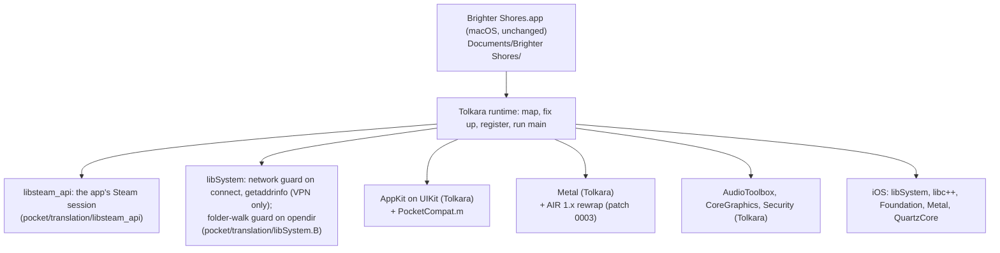

# Architecture

Brighter Pocket is a layer on [Tolkara](https://github.com/tolkara/tolkara), the runtime that
runs unmodified arm64 macOS applications on iOS (its own `platform/docs/ARCHITECTURE.md`
explains the loader, the API translation and the three ways to get executable memory). The
layer adds what Brighter Shores needs and Tolkara lacks, and nothing that changes the game: the
client's file is copied unchanged, and the device loads it as data.



## How the layer reaches the build

`platform/` is Tolkara at the commit in `pocket/platform.lock`, byte for byte.
`tools/prepare.py` copies it to `build/platform`, applies `pocket/patches/*.patch` in order and
copies in the files `pocket/overlay.map` lists, refusing to go on when a patch no longer applies,
an added file collides with one upstream now has, or a layer file is missing from the map. The
platform's own scripts and `tools/build_ios.py` then build from `build/platform` as if the layer
were part of Tolkara.

|change|kind|why|
|---|---|---|
|`translation/libsteam_api/`|new adapter|the client exits unless Steam initialises; Valve's library needs a Steam client. It lends the game the app's own Steam session|
|`launcher/Pocket/` + patch 0005|launcher addition + patch|signs in to Steam on the device before the game starts (no Steam client, no PC)|
|`translation/libSystem.B/`|new adapter|the network guard (`NetworkPolicy.c`: the game's connections through a VPN only) and the folder-walk guard (`ContainerPaths.c`)|
|`translation/AppKit/PocketCompat.m`|added to Tolkara's AppKit adapter|NSPasteboard, NSWorkspace, named cursors, `imageRepWithData:`, `CAMetalLayer displaySyncEnabled`|
|`translation/Metal/LegacyMetal.h` + patch 0003|helper + patch|the client's 536 shader libraries are AIR 1.8, which the on-device rewrap refused|
|patch 0004 (`tools/translate_metallib.py`)|patch|the Mac fallback for a refused shader library could not read AIR 1.x libraries either|
|patch 0001 (`tools/classify.py`)|patch|lets an adapter stand in for a library the application carries|
|patch 0002 (`tools/classify.py`)|patch|AudioToolbox's re-exported private framework made real functions look missing, and stubbed them|
|`profiles/brighter-shores/`|profile|names the game and its layout in Documents; `install.py` stages and copies it|

The patches carry their reasons. 0001 to 0004 are brand-free, so each could go upstream; 0005
names this game's profile.

## Steam

The client links `@loader_path/libsteam_api.dylib`. The staged copy leaves Valve's file out, so
the loader finds no carried library of that name and opens the adapter instead: by its leaf name
in a generic build (`Frameworks/aklibsteam_api.dylib`), through the library map in a build made
for the client (patch 0001 maps it). The adapter implements the eight flat functions the client
imports and the four interfaces it asks for, every slot filled (`docs/client-analysis.md`,
"Steam"). It opens no connection itself.

The account and its tickets come from the app. Before the game starts, the launcher calls
`launcher/Pocket/PocketSteamLaunch.m` (patch 0005), which signs in to Steam the way the Steam
client does, over a WebSocket to one of Steam's connection managers (`*.steamserver.net`):

```mermaid
sequenceDiagram
    participant L as Launcher (PocketSteamLaunch)
    participant S as Steam (connection manager)
    participant G as Game's Steam library (Steam.c)
    L->>S: hello; logon with the remembered refresh token
    Note over L,S: none yet: name and password (RSA-encrypted with Steam's key),<br/>Steam Guard code or approval in the Steam Mobile app,<br/>refresh token kept in the keychain
    S-->>L: logon response, account info, game connect tokens
    L->>S: ownership ticket for app 2791440; games played
    S-->>L: ownership ticket
    L->>L: start the game
    G->>L: PocketSteamBridgeGet (dlsym): account, then GetAuthTicketForWebApi(identity)
    L->>S: CMsgClientAuthList (session part, CRC, "str:identity")
    L-->>G: 2,560-byte web API ticket, by callback 168
```

The protocol is `PocketSteam.c`, plain C with no I/O, built the same for the device, the host
tests (`tests/steam_session_test.c`) and the live check against Steam (`tests/steam_live.py`).
The ticket is laid out as SteamKit2's `SteamAuthTicket` lays it out. The session stays connected
(heartbeats) while the game runs, as the ticket is valid only while it is. If the player chooses
to play offline, the bridge has no account and the adapter answers as a Steam that is running
but offline.

## The network guard

Tolkara resolves each of the client's libSystem imports through `aklibSystem.B.dylib`, which
re-exports the system's libSystem and defines `connect` and `getaddrinfo` itself (Tolkara's
classifier plans a re-exporting adapter for any library with a hand-written one). The launcher
and the other adapters link the system library directly, so only the game's own calls are
guarded: the launcher's Steam session above is not, and the game's own connections are. The
game may reach its servers through a VPN only (`docs/vpn.md`): while the system proxy settings
name a VPN's tunnel, lookups and connections are the system's and each is logged once as going
through the VPN; with none, host names fail with `EAI_NONAME` without a query and addresses
other than loopback with `ENETUNREACH`, both logged once.

The same adapter defines `opendir` (`ContainerPaths.c`): when the system refuses to open a
folder above the app's home folder, it opens the home folder instead, so the client's walk from
the root to its save folder carries on to `mkdir` the folders it needs
(`docs/client-analysis.md`, "Startup, emulated"). Any other `opendir` is the system's.

## Execution memory

The client never makes its own code writable, so all three of Tolkara's modes apply as
documented there. The Linux build preselects External JIT (a JIT enabler such as StikDebug
prepares the region); a Mac build can use Local signing with a page container made from the
executable itself, or Developer service.
