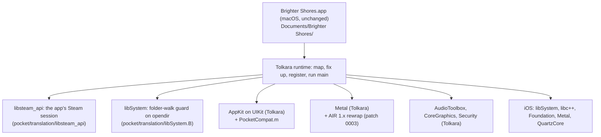

# Architecture

Brighter Pocket is a layer on [Tolkara](https://github.com/tolkara/tolkara), the runtime that
runs unmodified arm64 macOS applications on iOS (its own `platform/docs/ARCHITECTURE.md`
explains the loader, the API translation and the three ways to get executable memory). The
layer adds what Brighter Shores needs and Tolkara lacks, and nothing that changes the game: the
client's file is copied byte for byte, its SHA-256 checked before and after, and the device
loads it as data. Every difference from a Mac sits around it, in three places: adapters that
answer the client's macOS imports with iOS, the launcher that starts it, and patches to
Tolkara's own sources and tools.



## How the layer reaches the build

`platform/` is Tolkara at the commit in `pocket/platform.lock`, byte for byte.
`tools/prepare.py` copies it to `build/platform`, applies `pocket/patches/*.patch` in order and
copies in the files `pocket/overlay.map` lists, refusing to go on when a patch no longer applies,
an added file collides with one upstream now has, or a layer file is missing from the map. The
platform's own scripts and `tools/build_ios.py` then build from `build/platform` as if the layer
were part of Tolkara.

|change|kind|why|
|---|---|---|
|`translation/libsteam_api/`|new adapter|the client exits unless Steam initialises; Valve's library needs a Steam client. It lends the game the app's own Steam session|
|`launcher/Pocket/` + patch 0005|launcher addition + patch|signs in to Steam on the device (no Steam client on a phone) and keeps the game at Steam's build|
|patch 0028 (`launcher/App/main.m`)|patch|opening the app starts the game: no library to tap through; the sign-in and the update come before the start hashes the executable|
|`translation/libSystem.B/`|new adapter|the folder-walk guard (`ContainerPaths.c`): the sandbox refuses the folders above the app's, which the client opens on its way to its save folder|
|`translation/AppKit/PocketCompat.m`|added to Tolkara's AppKit adapter|NSPasteboard, NSWorkspace, named cursors, `imageRepWithData:`, `CAMetalLayer displaySyncEnabled`|
|`translation/AppKit/PocketSettings.m` + patches 0010 to 0013|added to Tolkara's AppKit adapter + patches|the in-game settings: a button beside the on-screen controls, frame rate, performance overlay, orientation, safe-area border, input, the Steam session's state (below)|
|patch 0025 (`translation/AppKit/TouchTrackpad.c`, `TouchControls.m`, `AppKit.m`)|patch|touch input: double-tap to right-click and a speed for the touch cursor, pinch to zoom in either input|
|patch 0026 (Info.plists)|patch|the game keeps running in the background while its sound plays, so switching apps keeps its sessions|
|`launcher/Pocket/PocketLoadingView.m`, `PocketSignInViewController.m` + patch 0027|layer files + patch|the layer's own screens, in iOS's own style: the loading screen with the game's name, its step in plain words and a progress bar from the runtime log's lines (the launcher's technical status under Details), the Steam sign-in as a form sheet (account and password, a Steam Guard code or an approval pushed over it, a problem with its way on), and the in-game settings as a sheet like the Settings app's|
|`translation/Metal/LegacyMetal.h` + patch 0003|helper + patch|the client's 536 shader libraries are AIR 1.8, which the on-device rewrap refused|
|patch 0004 (`tools/translate_metallib.py`)|patch|the Mac fallback for a refused shader library could not read AIR 1.x libraries either|
|patch 0001 (`tools/classify.py`)|patch|lets an adapter stand in for a library the application carries|
|patch 0002 (`tools/classify.py`)|patch|AudioToolbox's re-exported private framework made real functions look missing, and stubbed them|
|patches 0006 to 0008|patches|`classify.py` finds the SDK of whichever Xcode is selected; shader translations for the iOS Simulator, whose Metal runs no desktop AIR|
|patch 0009 (`tools/build_signed_container.py`)|patch|Local signing for this client (below)|
|`launcher/Pocket/PocketLocalSigning.m`, `tools/give_signing_identity.sh` + patches 0014, 0024|launcher addition, tool + patches|the app signs a new game build's page container itself (below)|
|`management/`, `layer.env` + patches 0020 to 0023, 0034, 0035, 0037 to 0041|companion + patches|Tolkara Management made into Brighter Pocket Companion ([README](../README.md#set-up)), with its own updates (Sparkle) and What's New ([releasing.md](releasing.md)); the app "Pocket" on the Home Screen and Brighter Pocket in its own text, carrying only this game's profile, and the companion set up for this game alone|
|`profiles/brighter-shores/`|profile|names the game and its layout in Documents; `install.py` stages and copies it|

The patches carry their reasons. Most are brand-free and could go upstream; 0005 and the
companion's name this game.

## Steam

The client links `@loader_path/libsteam_api.dylib`. The staged copy leaves Valve's file out, so
the loader finds no carried library of that name and opens the adapter instead: by its leaf name
in a generic build (`Frameworks/aklibsteam_api.dylib`), through the library map in a build made
for the client (patch 0001 maps it). The adapter implements the eight flat functions the client
imports and the four interfaces it asks for, every slot filled (`docs/client-analysis.md`,
"Steam"). It opens no connection itself.

The account and its tickets come from the app. Opening the app starts the game (patch 0028:
Tolkara's library shows only when there is no game to start); before it starts, the launcher
calls `launcher/Pocket/PocketSteamLaunch.m` (patch 0005), which signs in to Steam the way the
Steam client does, over a WebSocket to one of Steam's connection managers (`*.steamserver.net`):

```mermaid
sequenceDiagram
    participant L as Launcher (PocketSteamLaunch)
    participant S as Steam (connection manager)
    participant G as Game's Steam library (Steam.c)
    L->>S: hello; logon with the remembered refresh token
    Note over L,S: none kept: the game starts first, offline;<br/>at its main menu, name and password (RSA-encrypted with Steam's key),<br/>Steam Guard code or approval in the Steam Mobile app,<br/>refresh token kept in the keychain
    S-->>L: logon response, account info, game connect tokens
    L->>S: ownership ticket for app 2791440; games played
    S-->>L: ownership ticket
    L->>S: the branch's build (PICS), within 6 s
    L->>L: an update in place, then start the game
    G->>L: PocketSteamBridgeGet (dlsym): account, then GetAuthTicketForWebApi(identity)
    L->>S: CMsgClientAuthList (session part, CRC, "str:identity")
    L-->>G: 2,560-byte web API ticket, by callback 168
```

The protocol is `PocketSteam.c`, plain C with no I/O, built the same for the device, the host
tests (`tests/steam_session_test.c`), and the emulator's live session (`emulator/src/steam.rs`),
whose by-hand test checks it against Steam itself.
The ticket is laid out as SteamKit2's `SteamAuthTicket` lays it out. The session stays connected
(heartbeats) while the game runs, as the ticket is valid only while it is. Until the player
signs in (or if they choose not to), the bridge has no account and the adapter answers as a
Steam that is running but offline; the bridge is asked on every call, so a sign-in while the
game runs reaches it at once.

The game starts as soon as it can. With a kept login the sign-in takes a second or two; with
none, the game starts offline and the sign-in is offered over its main menu, a few seconds
after its window comes up (`PocketSteamGameReady`, from the in-game settings; Not Now leaves it
to the settings). A kept login Steam no longer accepts does the same, saying why. Steam out of
reach with a kept login starts the game offline too, and the keepalive below signs in with the
login as soon as Steam answers.

A connection can die quietly: iOS closes an app's sockets while it is suspended, and a network
change strands them, with nothing said. A ticket made on such a connection never reaches Steam,
and the game's servers refuse it, every time the player tries. So the app checks:

- every 30 s, and as the app comes back to the front, a WebSocket ping must come back within
  5 s, or the connection is made again with the kept login;
- a ticket counts only once Steam acknowledges it (`CMsgClientAuthListAck`), within 10 s; if
  not, the connection is made again and a second ticket made on it;
- a connection manager that does not answer is skipped for the next of the five the directory
  lists first;
- Steam's playing-session state (`CMsgClientPlayingSessionState`) says whether a game runs on
  another of the account's sessions. Before the game starts, the app asks the player when one
  does ("Play here" closes it there; Steam lets one session play at a time), and the settings
  show it while the game runs. Once this session plays, an earlier block is over (often a
  session that ended without logging off, still counted as playing for a while), so it is
  cleared until Steam reports another (`pocket_steam_games_played`).

What the player sees of the session (`PocketSteamCurrentState`, and a notification on each
change) shows in the in-game settings: signed in as whom, reconnecting, Steam unreachable, the
game running on another device, or a kept login Steam refused, with Sign in to Steam to put it
right while the game runs (`PocketSteamSignInAgain`).

## Updates

The app keeps the game at Steam's build itself, as the Steam client would, with no Mac
(`launcher/Pocket/PocketDepot.m` for Steam's content system, `PocketInstalledGame.m` for the
files, `PocketGameUpdates.m` for the service and its screens):

1. Steam's app info (PICS: an access token, then the product info, or its HTTP copy) names the
   chosen branch's build, when Steam published it, and the macOS depot's manifest. A branch
   that has gone falls back to the public one; one with a password is not offered.
2. The build on the device is recorded (`Library/Application Support/Updates/installed.json`)
   with its executable's SHA-1. A game copied from the Mac is told by comparing that SHA-1 with
   the manifest's.
3. A different build is fetched into a staging folder: the manifest (by its request code, from
   the content servers Steam lists), decrypted with the depot key; each file whose chunks match
   the build on the device is cloned (APFS, no space used), the rest is put together from chunks
   the device has and chunks downloaded (eight at once, AES, then zstd or LZMA), each chunk's
   SHA-1 checked. Free space is checked first; a fetch cut short (network, the app sent away)
   resumes. Valve's `libsteam_api.dylib` is left out, as the copy from the Mac leaves it.
4. A complete build takes the game's place before the game starts, never while it runs; the
   one before is kept until the game's window comes up with the new one. A new build that has
   not started by its second try is offered back ("Go Back"), and is not fetched again until
   Steam has another.

When: each time the app opens, signed in, before the game starts. Steam answering within 6 s,
a newer build downloads there and then, its progress on the loading screen, and goes in place;
slower, the game starts as it is and the check goes on behind it. While the game runs, Steam is
asked again every ten minutes, and at once after a sign-in; a newer build then downloads in the
background and goes in place the next time the app opens. A notice over the game says which:
up to date, downloading, or ready. Settings › Builds shows the build on the device and Steam's,
the branch, when Steam was last asked, the download's progress, and Check for Updates.

Builds read as brighter-atlas shows them: when Steam published the build, in UTC, and the
game's own version from its `Info.plist`, as `11-Nov-2026 15:19 UTC (v0.104.2)`
(`PocketBuildLabel`). For a build not yet on the device, its `Info.plist` alone is fetched.

What older builds leave goes once a new one has started: the build before, staged builds no
newer than the one on the device, and the page containers (`Documents/LocalSigning/<SHA-256>.dylib`)
of executables no longer on it. A download uses Steam's content servers over HTTPS and the
app's own session: other devices on the account are not signed out. The code signing is the
same as for a copied build: the app signs the new executable's pages the first time it starts.

## Usage counts

`launcher/Pocket/PocketAnalytics.m` sends anonymous counts to Umami Cloud
(`POST https://gateway.umami.is/api/send`), to the brighteratlas.com website there, under the
hostname `app.brighteratlas.com`: one JSON event per count, as Umami's own tracker sends from a
page, with the language, the screen in points and a User-Agent shaped as an iOS web view's
(the real iPhone or iPad and iOS version, then `BrighterPocket/<version>`), so Umami's bot
filter takes it and reads the device from it. The events: `app-open` (version, device, iOS
major version), `app-signin-shown`, `app-signin-later` (Not Now), `app-signin` (result `ok`,
`failed` or `cancelled`; guard `none`, `email`, `app` or `code`; on failure the EResult or a
short word) for a sign-in with an account and password, `app-signout`, `app-game-start` (the
game's window up), `app-game-update` (the check before the start: `ok`, `failed` or `none`) and
`app-renew-warning` (whole days left). A field is a short string, a number or a Boolean, and
nothing else goes: never the Steam account, its ID, a token or password, an email, the
device's name, a path or anything of the game. The request is fire and forget on an
ephemeral session (no cookies, a 10 s timeout); a failure is dropped. Off when the player
turns off Anonymous Usage Counts (`PocketAnonymousUsageCounts`, on by default), in the iOS
Simulator, with `POCKET_NO_ANALYTICS=1` in the environment, or under a test runner.

## The folder walk

Tolkara resolves each of the client's libSystem imports through `aklibSystem.B.dylib`, which
re-exports the system's libSystem and defines `opendir` itself (Tolkara's classifier plans a
re-exporting adapter for any library with a hand-written one); the launcher and the other
adapters link the system library directly. When the system refuses to open a folder above the
app's home folder, it opens the home folder instead, so the client's walk from the root to its
save folder carries on to `mkdir` the folders it needs (`docs/client-analysis.md`, "Startup,
emulated"). Any other `opendir` is the system's. The client's network calls are iOS's own.

## In-game settings

A gear button sits beside Tolkara's on-screen keyboard and trackpad buttons (at their place
when they are off; bottom right unless the player chooses another corner) and opens a sheet in iOS's own style, an inset grouped list as the
Settings app shows. Each choice is kept in the app's `NSUserDefaults`
and takes effect at once, while the game runs:

|setting|key|default|how|
|---|---|---|---|
|Steam|(the session)|-|who is signed in, or what is wrong and what happens next; Sign in to Steam (again). A dot on the gear (yellow: reconnecting or a warning, red: unreachable or a sign-in needed) and a short notice at the top show changes while the sheet is closed|
|Builds|`PocketSteamBranch`|`public`|the Builds screen (above, "Updates"), its row showing the build on the device and whether it is up to date|
|Performance overlay|`PocketPerformanceOverlay`|off|top left of the game: presented frames a second and the frame time, from the drawables' presentation times; the target (the cap, or the screen's maximum), the rate the game's own presents ask for, the longest gap, the GPU time of a frame and the longest wait for a drawable (what holds the rate back: the GPU, or the display)|
|Frame rate|`PocketFrameRate`|0, Max|Max is the screen's own rate (`maximumFramesPerSecond`, 120 with ProMotion); below it, the steady rates down to 30 (120: 80, 60, 40, 30; 60: 30). A cap lengthens the minimum duration of the game's `presentDrawable:afterMinimumDuration:`; a present that asks for more keeps its own. A display link asks Core Animation for the target rate: without it a ProMotion screen stayed at 60 Hz (13 ms waits for a drawable against 0.7 ms of GPU)|
|Orientation|`PocketOrientation`|`device` (Rotate)|landscape, portrait, or as the device is held (the launcher's own screens always turn with it, patch 0012). The game's window takes the view's size (`window content size -> WxH` in the log)|
|Keep clear of notch and corners|`PocketSafeArea`|off|the game's view inside the safe area and clear of the screen's rounded corners (inset by r(1 - 1/sqrt 2) from each edge, r the screen's corner radius), black around it; again when the game moves to the other screen of the iPhone Duo|
|Input|`AKTouchTrackpadEnabled` (Tolkara's)|touch|touch: a finger is the mouse where it touches. Cursor: Tolkara's touch trackpad, slide to move the cursor, tap to click, double-tap or two-finger tap to right-click, two fingers to scroll, hold to drag (patch 0025)|
|Cursor speed|`AKTouchTrackpadSpeed`|1|0.5 to 3 times the finger's travel; shown with Cursor input|
|Pinch to zoom|`AKTouchPinchScrolls`|on|two fingers pinching send scroll-wheel lines, the game's zoom, in either input; without the trackpad a press waits 80 ms for a second finger, so a pinch never clicks|
|On-screen buttons|`PocketButtonsHidden`|shown on iPhone, hidden on iPad|a small handle beside them folds the gear and Tolkara's keyboard and trackpad buttons away, and brings them back|
|Button position|`PocketButtonsCorner`|`bottomRight`|the corner the on-screen buttons sit in: `bottomRight`, `bottomLeft`, `topRight` or `topLeft`. The keyboard's button is at the corner, the handle furthest from it, its chevron pointing into the corner to fold them away. At the bottom they keep above the keyboard; at the top, below the safe area's top and clear of the rounded corner. With them at the top, the Steam notice shows at the bottom; at the top left, the performance overlay moves to the top right|
|Button layout|`PocketButtonsVertical`|off (Horizontal)|a row, or a column (Vertical); patch 0032 lets Tolkara's two buttons stack and swap ends|
|Anonymous usage counts|`PocketAnonymousUsageCounts`|on|the app's counts to Umami (above, "Usage counts"); off sends nothing. The switch reads and sets it through the launcher's `PocketAnalyticsEnabled` and `PocketAnalyticsSetEnabled`, found with dlsym|

The cursor takes the shape the game asks for: the named cursors it sets (a pointing hand over
what it can click, an I-beam over text) are drawn from SF Symbols (`PocketCompat.m`), for the
touch cursor and a connected mouse's pointer alike.

Patch 0010 makes the game window's controller view a black root with Tolkara's game view
(`AKHostView`) inside it, where `PocketSettings.m` constrains it to the safe area or the whole
screen and adds the button, the overlay and the sheet. Patch 0011 makes Tolkara's
presentation hooks (`translation/Metal/Presentation.m`, until then behind `--measure-native`)
install for every game: they time each presented drawable and apply the cap, and
`AKPresentationPacing` hands both to the settings. Patch 0012 lets the game's window take the
orientations its controller answers while the launcher keeps Info.plist's (landscape on
iPhone); patch 0013 sets `CADisableMinimumFrameDurationOnPhone`, without which an iPhone
presents at 60 Hz at most. For development, `--open-settings` opens the sheet (`--open-builds`, Builds; `--open-about`, About) when the game's
window appears, and `--settings-demo` then closes it and changes each setting in turn over the game, three seconds apart;
`tools/run_simulator.py --offline` plays offline at once, to reach them without Steam.

## Execution memory

iOS runs only signed code, and the client's code is the Mac's. Tolkara has three ways round
that; the client never makes its own code writable, so all three apply:

- **Local signing** (the default here): a page container, a signed copy of the client's own
  `__TEXT` pages, signed with the user's developer certificate. The Mac makes the first one
  with `codesign` (`tools/build_signed_container.py`; `pocket/patches/0009` lets it take this
  client's chained fixups and `__init_offsets`, after checking that no fixup lands in
  `__TEXT`). The app makes one itself for a build that has none
  (`launcher/Pocket/PocketLocalSigning.m`, patch 0024): the same container, byte for byte
  (`tests/run.sh` compares them), signed by Tolkara's own signer (`tools/sign_guest_local.m`,
  Security and CommonCrypto only; patch 0014 lets it run inside an app) with the identity
  `tools/give_signing_identity.sh` gave the app once: a PKCS#12 file under a random passphrase
  that reaches the app only as a launch argument, kept in the app's keychain, the file deleted.
  So a game update needs no Mac to sign it. The key then lives in the app's keychain, which the
  game's own code, running in the same process, could read as it could the Steam token; the
  tools give it again when the Mac's certificate changes (its SHA-1 differs from the note the
  app keeps). The device maps those pages as ordinary
  developer-signed code. No tunnel, no enrolment, no wait at launch. The container is a
  separate file beside the game; the game file is untouched, and the runtime refuses a
  container whose header and load commands differ from the game's.
- **Developer service**: the device's own debugging service prepares executable memory through
  Tolkara's on-device tunnel (a VPN configuration that carries only that). Needs a one-time
  enrolment from the Mac and about 20 s at each launch. The launcher must enter the game from a
  run-loop timer callout, as `PocketSteamLaunch.m` does after the Steam sign-in: from a
  main-queue block, the preparation would wait for good on replies the main queue delivers.
- **External JIT**: a sideloaded build with JIT enabled by StikDebug or SideStore.

## In the background

The audio adapters hold an `AVAudioSession` in the playback category while the game's sound
runs; with `UIBackgroundModes` `audio` (patch 0026) iOS keeps the app running while it plays,
so switching to another app (a browser, the Steam Mobile app for a Steam Guard code) leaves the
game and its connections as they were. Metal work the game submits meanwhile is iOS's to
refuse; the game draws again in the front.
