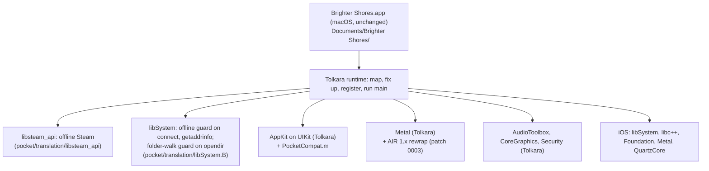

# Architecture

Brighter Pocket is a layer on [Tolkara](https://github.com/tolkara/tolkara), the runtime that
runs unmodified arm64 macOS applications on iOS (its own `platform/docs/ARCHITECTURE.md`
explains the loader, the API translation and the three ways to get executable memory). The
layer adds what Brighter Shores needs and Tolkara lacks, and nothing that changes the game: the
client's file is copied unchanged, and the device loads it as data.

## How the layer reaches the build

`platform/` is Tolkara at the commit in `pocket/platform.lock`, byte for byte.
`tools/prepare.py` copies it to `build/platform`, applies `pocket/patches/*.patch` in order and
copies in the files `pocket/overlay.map` lists, refusing to go on when a patch no longer applies,
an added file collides with one upstream now has, or a layer file is missing from the map. The
platform's own scripts and `tools/build_ios.py` then build from `build/platform` as if the layer
were part of Tolkara.

|change|kind|why|
|---|---|---|
|`translation/libsteam_api/`|new adapter|the client exits unless Steam initialises; Valve's library needs a Steam client|
|`translation/libSystem.B/`|new adapter|the offline guard (`NetworkPolicy.c`) and the folder-walk guard (`ContainerPaths.c`)|
|`translation/AppKit/PocketCompat.m`|added to Tolkara's AppKit adapter|NSPasteboard, NSWorkspace, named cursors, `imageRepWithData:`, `CAMetalLayer displaySyncEnabled`|
|`translation/Metal/LegacyMetal.h` + patch 0003|helper + patch|the client's 536 shader libraries are AIR 1.8, which the on-device rewrap refused|
|patch 0001 (`tools/classify.py`)|patch|lets an adapter stand in for a library the application carries|
|patch 0002 (`tools/classify.py`)|patch|AudioToolbox's re-exported private framework made real functions look missing, and stubbed them|
|`profiles/brighter-shores/`|profile|names the game and its layout in Documents; `install.py` stages and copies it|

The patches carry their reasons and are brand-free, so each could go upstream.

## Steam

The client links `@loader_path/libsteam_api.dylib`. The staged copy leaves Valve's file out, so
the loader finds no carried library of that name and opens the adapter instead: by its leaf name
in a generic build (`Frameworks/aklibsteam_api.dylib`), through the library map in a build made
for the client (patch 0001 maps it). The adapter implements the eight flat functions the client
imports and the four interfaces it asks for, every slot filled, with the answers of a Steam that
is running but offline (`docs/client-analysis.md`, "Steam"). It never connects to anything.

## The offline guard

Tolkara resolves each of the client's libSystem imports through `aklibSystem.B.dylib`, which
re-exports the system's libSystem and defines `connect` and `getaddrinfo` itself (Tolkara's
classifier plans a re-exporting adapter for any library with a hand-written one). The launcher
and the other adapters link the system library directly, so only the game's own calls are
guarded. Host names fail with `EAI_NONAME` without a query; addresses other than loopback fail
with `ENETUNREACH`; both are logged once. Removing `NetworkPolicy.c` (and its overlay entries)
is the one change that would let the game reach the network.

The same adapter defines `opendir` (`ContainerPaths.c`): when the system refuses to open a
folder above the app's home folder, it opens the home folder instead, so the client's walk from
the root to its save folder carries on to `mkdir` the folders it needs
(`docs/client-analysis.md`, "Startup, emulated"). Any other `opendir` is the system's.

## Execution memory

The client never makes its own code writable, so all three of Tolkara's modes apply as
documented there. The Linux build preselects External JIT (a JIT enabler such as StikDebug
prepares the region); a Mac build can use Local signing with a page container made from the
executable itself, or Developer service.
